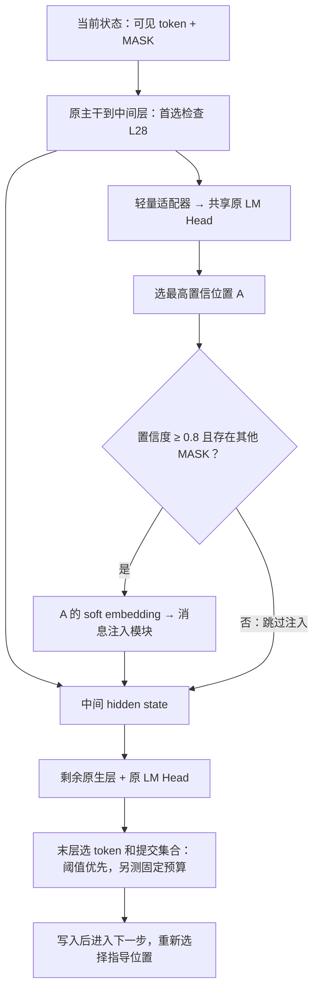

# 单个高置信 Soft Draft 指导的 On-policy Self-distillation

**核心思路：在中间层通过一个轻量读出适配器复用原 LM Head，选出当前置信度最高的一个 MASK 位置；当其置信度达到 0.8 时，将该位置的 soft draft 注入中间表示，让剩余原生层利用它预测其他位置。最终由末层决定内容和提交集合。从一开始就采用固定阈值、自适应步数解码，再补充固定预算实验；以最终准确率与实际解码时延验证效果。**

## 1. 研究目标与本版取舍

dLLM 的双向 attention 已让不同位置共享隐藏上下文，但并行输出通常没有再条件于其他位置本次实际选出的 token identity。我们先研究一个更小的问题：**把一个高置信位置的候选分布提前显式读出来，能否帮助剩余层作出更好的预测？**

本版只做一次单源 soft guidance，不要求所有位置同时互相修正，也不提前锁定硬 token。中间层固定的是本轮指导消息，指导位置的最终 token 仍可改变。因此，这是 soft proposal guidance，不是 early commitment，也不保证最终整组 token 已满足联合一致性。

多步去噪允许每步重新选择指导位置；本步实际写入的硬 token 会成为下一步的可见上下文。后续步骤能继续调整尚未提交的位置，但普通单调解码不会自动修正已经写错的 token。先验证这一简化机制；只有出现有效信号后，再考虑有限轮候选修正。

**采用 OPSD 的理由：** 在 Student 自身生成的状态上，用冻结 Teacher 的完整预测监督早期读出，并尝试用 Teacher 读取指定候选后的条件预测监督指导效果。这里的条件来自本步 soft draft，区别于原 d-OPSD 的 self-future PI；条件 Teacher 的具体近似仍须验证。

## 2. 架构：一个早期读出头，一个消息来源

### 2.1 轻量适配器复用原 LM Head

以 32 层模型的 L28 为起始候选，记中间层为 $\ell$，末层为 $L$。冻结原主干、token embedding、final normalization 和 LM Head；新增一个轻量读出适配器 $g_\phi$，以及一个消息注入模块 $J_\psi$。

**连接顺序为“中间 hidden state → 轻量适配器 → 原 final normalization → 共享 LM Head”。** 本文沿用前面讨论的 hidden-state 适配方案；词表 logits 后的修正头是另一种实现，未纳入首版。最终层继续使用原输出路径，不经过这个早期适配器。

$$
H^\ell=F_{1:\ell}(S_t),\qquad
r_i=\operatorname{softmax}\!\left(W_{\rm LM}\operatorname{Norm}(g_\phi(h_i^\ell))\right).
$$

$g_\phi$ 可采用小型残差瓶颈或低秩适配，初始为恒等映射。$r_i$ 同时提供 token 分布和位置置信度，**不再设置独立位置头，也不再使用位置排序 loss**。原 LM Head 直接读取中间层，即 $g_\phi=\operatorname{Identity}$，作为读出基线。

相比直接复用未适配的 LM Head，训练适配器允许中间表示对齐原词表映射；相比新增完整词表头，参数成本较小。哪种读出更可靠仍需测量。新增模块中只有一个预测头；$J_\psi$ 负责传递消息，不输出另一套词表分布或位置分数。

### 2.2 选择一个最高置信位置，0.8 门控

令 $M_t$ 为当前可解码 block 中尚未提交的位置。若 $|M_t|\leq1$，没有其他 Receiver，直接跳过指导。否则：

$$
s_i=\max_v r_i(v),\qquad
A=\arg\max_{i\in M_t}s_i,\qquad
z_t=\mathbf 1[s_A\geq\tau_{\rm msg}],\quad \tau_{\rm msg}=0.8.
$$

平分时按固定位置顺序选择。每步最多发送一条指导消息。**0.8 是首版待验证的消息门控，不是已证明最优的阈值，也不代表实际正确率一定达到 80%。** 它比 0.9 允许更多步骤参与指导，同时保留对明显低置信 draft 的过滤；收益取决于置信度校准与消息质量。

### 2.3 Soft draft 注入与后续计算

将 A 的完整候选分布转换为 soft embedding：

$$
m_A=\sum_{v\in\mathcal V}r_A(v)E(v).
$$

这里的 argmax 仅用于选择位置，不把消息硬化为某个 token，也不在 Student 路径采样硬 Anchor。将消息经适配后注入 A 的 residual stream：

$$
\widetilde h_A^\ell=h_A^\ell+z_tJ_\psi(h_A^\ell,m_A),\qquad
\widetilde h_i^\ell=h_i^\ell\quad(i\neq A),
$$

$$
p^{\rm final}=\operatorname{Head}\!\left(F_{\ell+1:L}(\widetilde H^\ell)\right).
$$

消息注入输出从零初始化。其他位置通过后续原生双向 attention 读取消息，不增加专门的组内 attention 或本步循环。单源指导不限制原生 attention 的其他交互，A 自己的末层预测也可能变化。门控关闭时，$\widetilde H^\ell=H^\ell$，数值输出应与原模型一致，但中间读出仍有运行开销。

**不强制提交 A，不固定其最终身份，也不要求 A 属于本步末层提交集合。** 中间层选择消息来源，最终层选择写入内容与位置。

## 3. 解码协议：从固定阈值开始，兼测固定预算

### 3.1 主协议：固定阈值、自适应步数

从首次机制验证、训练数据采集到任务评测，都优先使用固定阈值解码。先以 $\tau_{\rm commit}=0.9$ 为起始设置；这与消息门控 $\tau_{\rm msg}=0.8$ 是两个不同参数。

以 greedy 解码为例，在指导后的最终分布上计算：

$$
\hat x_i=\arg\max_v p_i^{\rm final}(v),\qquad
c_i=p_i^{\rm final}(\hat x_i),\qquad
C_t=\{i\in M_t:c_i>\tau_{\rm commit}\}.
$$

若 $C_t$ 为空，提交最终层置信度最高的一个位置，保证推进。带温度采样时，沿用原生成器，以实际候选 token 在原预测分布中的概率计分，不把它与最大概率混用。

- A 未达到末层提交阈值时，可以继续保持 MASK。
- Receiver 经指导后达到阈值，可以在当前步提交；变得不确定的位置继续等待。
- 消息门控关闭时，仍执行正常的末层阈值提交和至少一个 token 的兜底规则。
- 每步提交数量不固定，去噪步数自适应；不预先预测完整提交集合。

消息门控判断“早期分布是否值得用于指导”，提交阈值判断“最终预测是否可以写入”。它们来自不同层，不能假定相同数值具有相同可靠性。阈值选择应使用独立开发集，并报告覆盖率和实际可靠性。

### 3.2 补充协议：固定预算

固定预算实验保留原调度给出的每步提交数 $k_t$。使用指导后的**最终层**候选置信度，选择当前 MASK 中得分最高的 $k_t$ 个位置提交。A 不预占额度、不强制进入集合，选择指导消息本身不消耗提交额度。

即使本步 $k_t=1$，只要仍有多个 MASK，指导也可以启用；是否需要跳过由是否存在 Receiver 和消息门控决定。历史 256 generated tokens / 128 steps / block length 32 可作为 LLaDA 的参考设置，但不同模型、长度和停止协议下的结果不直接混比。

**实验顺序是阈值解码在先，固定预算在后。** 两种协议都比较匹配设置下的 base 与本方法。若训练或微调到固定预算协议，应重新采集相应状态；也可先评估阈值训练模型的直接迁移，但须明确标注训练与测试协议的差异。

## 4. Teacher 的两个监督目标

Teacher 是冻结的原模型，只在训练时提供目标。Student 是原模型加早期适配器与消息注入模块。Teacher 和 Student 必须匹配模型、tokenizer、prompt 与状态定义。

### 4.1 普通 Teacher：监督早期读出

普通 Teacher 输入与 Student 相同的去噪状态 $S_t$，输出完整模型分布 $q_i^0=T_i(S_t)$：

$$
\mathcal L_{\rm draft}
=\operatorname{mean}_{i\in M_t}\mathrm{KL}(q_i^0\Vert r_i).
$$

只更新 $g_\phi$。可分块或抽样 MASK 位置计算，确保覆盖实际选中的指导位置及其他候选位置。这个目标让早期分布接近完整模型，**不等于学会唯一正确的硬 token，也不监督最优解码顺序**。必须另测最高置信位置的可靠性与指导价值。

### 4.2 条件 Teacher：监督收到 soft draft 后的响应

对本步选出的 A，仅在 Teacher 输入中将 A 揭示为候选 $v$，其余位置保持 $S_t$ 原样，Receiver $B\in M_t\setminus\{A\}$ 仍为 MASK：

$$
q_B^v=T_B(S_t^{+A=v}).
$$

Student 使用的是 $r_A$ 而非一个已确定的硬 token，因此本版的候选 soft 条件目标为：

$$
\bar q_B=\sum_v r_A(v)q_B^v,\qquad
\mathcal L_{\rm cond}
=\operatorname{mean}_{B\in M_t\setminus\{A\}}
\mathrm{KL}(\bar q_B\Vert p_B^{\rm final}).
$$

该项只在消息门控开启且存在 Receiver 时使用，Receiver 不限于最终提交集合。训练通信时固定 $g_\phi$，对 $r_A$ 和 Teacher 目标停止梯度；梯度穿过冻结尾层，只更新 $J_\psi$。目标是学习 Receiver 的条件预测响应，不是直接监督某些 attention 权重变大。

**条件 Teacher 仍是待验证部分：**

- 对完整词表逐一运行 Teacher 不现实。可从 $r_A$ 采样，或截取 top-K 并重新归一化近似；记录样本数、保留的概率质量和目标近似误差。每个候选的一次 Teacher 前向可同时监督多个 Receiver。
- 高置信消息通常更集中，有利于近似，但平均可能削弱条件响应。先测目标相对 $q_B^0$ 是否有有效变化。
- 只用 argmax 硬候选的 Teacher 是另一种近似，不能声称与 Student 的 soft 条件完全相同；也不能将 soft embedding 注入等同于对硬条件预测精确求平均。
- 在相同 $S_t$、相同 A 上改变消息并重算 Teacher 目标，检查 Student 是否产生对应响应，避免只凭一个 KL 数字认定它使用了消息。人工扰动需注意与自然消息分布的差异。

本版只有早期读出与条件响应两个候选训练目标，不添加位置 loss、最终正确率奖励或 GRPO。Teacher 揭示的候选也可能错误；条件蒸馏不能替代对指导可靠性的验证。

## 5. 训练与数据流程

1. **先采集阈值轨迹，建立读出基线。** 在独立分析集的真实状态上测原 LM Head 的中间读出，重点看每步 top-1 指导位置在 0.8 门控下的覆盖率、与末层预测的一致性、条件指导价值。0.9 可作为更保守门控的对照。
2. **阶段一：训练早期适配器。** 关闭消息，以原模型的阈值解码轨迹构造 $q_i^0$，只训练 $g_\phi$；原最终输出路径保持冻结。没有消息时，早期读出不改变提交策略。训练后在同一独立分析集复测读出可靠性与门控覆盖率。
3. **验证条件目标，再训练消息注入。** 固定早期读出，在当前 Student 实际选中的 A、实际 $r_A$ 上构造候选条件目标。确认可靠性和条件目标有信号后，只训练零输出初始化的 $J_\psi$。
4. **刷新 on-policy 状态。** 消息会改变最终分布、阈值提交集合与后续状态，阶段二需使用当前 Student 的阈值 rollout 持续更新数据。训练和推理执行同一套选位置、门控与注入规则。
5. **再扩展协议与模型。** 补固定预算对照，并尽早验证 iLLaDA 的读出与指导可行性；不把 LLaDA 的层位、置信度或效果直接移植为结论。

保存正确与错误 rollout。若初版沿用“仅最终答案验证正确的轨迹用于训练”的筛选，应明确这是数据筛选条件，不能将其视为全部局部 draft 正确；错误轨迹仍用于诊断，完整任务评测不按最终正确性筛选。采样与 checkpoint/阈值选择使用独立数据，避免在最终测试集反复选方案。

## 6. 模型迁移与验证标准

### 6.1 LLaDA 与 iLLaDA

LLaDA 可用于已有管线上的机制验证，iLLaDA 是后续强模型验证的明确目标。两者均为 32 层，但中间表示与置信度成熟时机需要分别测量，L28 只是起始候选。

[iLLaDA 原文](https://arxiv.org/abs/2606.25331)给出的隐藏维度为 4096、词表大小为 155,136，输入 embedding 与 LM Head 共享权重。完整新增词表矩阵约需 6.35 亿参数，因此优先复用冻结的原输出映射并训练小型适配器。这里的“共享”指同一个模型的早期与最终读出共享，不是跨模型共享权重。

iLLaDA 的变长分块生成与 low-confidence remasking 不强制要求固定数值阈值；固定阈值是我们选定的主实验协议。迁移时核对 tokenizer、MASK/EOS/stop token、归一化、生成长度与停止规则，重新训练或校准该模型的适配器、注入模块和阈值。不能仅修改模型名后假定完全兼容。

### 6.2 准确率与实际速度均可提供有效性证据

**提高最终准确率，或在质量相近时缩短实际解码时间，都能支持方法有效；不要求二者同时提升。** 若两者存在取舍，报告准确率—时延曲线。固定阈值下，一个重要假设是：指导让部分原本需要下一步的位置更早达到可靠提交条件，从而减少前向次数。

历史阈值协议的 sibling 冲突小于固定预算，说明可修复空间可能更小；这些旧观察不是 iLLaDA 上的效果预测。不要只把置信度上升或步数减少当作成功，它们也可能来自过度自信。中间词表投影、soft embedding 与消息注入的额外开销必须计入实际时延。

最小验证内容：

- **原模型基线与关闭注入的数值一致性：** 确认适配器只在早期分支使用，关闭消息时原 logits 和提交行为保持一致；随机解码比较时固定采样随机性。
- **读出对照：** 直接共享 LM Head 与训练轻量适配器，在同一批状态上比较 top-1 指导位置的可靠性和 0.8/0.9 门控覆盖率。
- **指导效果：** 在匹配解码参数下比较 base 与本方法；使用同等计算开销、改变消息内容的对照，区分具体消息信息与额外计算/模块的贡献。
- **任务与时延：** 报告完整分析集/测试集准确率、实际端到端生成时间、前向次数、每步提交量、门控触发率和最终提交 token 的可靠性，并给出不确定性。分开报告 Teacher 训练成本与 Student 推理成本。
- **协议一致性：** base 与本方法匹配 prompt、温度、最大长度、block、停止与答案抽取规则。先比较相同阈值，再在独立开发集选阈值比较准确率—时延曲线；固定预算结果单独报告。

## 7. 方法边界与后续方向

单源 soft feedback 本身不构成已成立的创新。已有中间预测反馈方法需要比较；[DFlash](https://arxiv.org/abs/2602.06036)使用并行 draft，[DSpark](https://arxiv.org/abs/2607.05147)进一步用轻量 Markov/RNN 模块条件于已采样前缀。我们当前验证的是：**能否将选择性的 soft draft 指导放进 dLLM 自身的深度计算中，通过 on-policy 条件监督获得实际准确率或时延收益。** 原生 attention 已有信息共享，不能将本方法描述成首次让 token 互相可见。

本版不声称消除了循环依赖、不锁定硬 Anchor、不增加 Partial Loop，也不训练完整解码顺序。若单源指导有效，再尝试有限轮候选修正；新增循环必须有同等额外计算的对照并实测时延。若早期可靠性、条件目标或实际收益不成立，应据此调整假设，而不是预先堆叠更多 head 或循环。
